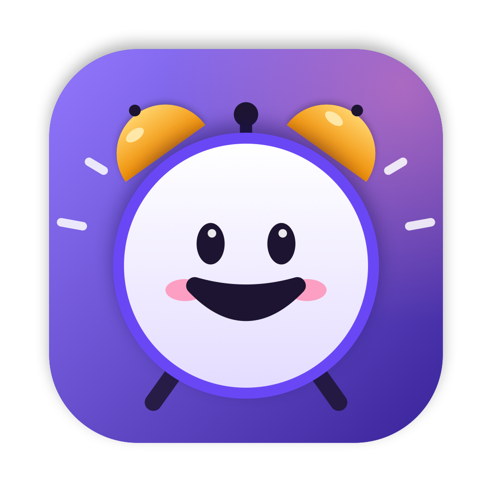

# TaskAlarm brand language

> **The to-do list that cheers you on.**

TaskAlarm is a small, friendly coach that lives in your menu bar. Everything about the brand
(look, words, sound) should feel like a friend who's happy to see you get things done, never a
nagging boss.

---

## Personality

| We are | We are not |
| --- | --- |
| Warm, upbeat, encouraging | Preachy, guilt-tripping, passive-aggressive |
| Playful, a little cheeky | Childish or noisy |
| Short and clear | Corporate or wordy |
| Calm even when you're late | Alarmist |

## The mascot: Smiley

The smiley is the brand. In the app icon it's an **alarm clock**: two amber bells, a little
hammer, tiny feet. In the menu bar it's just the face, and its color shows the state:

| State | Color | Face |
| --- | --- | --- |
| All clear | 🟢 `#34C77B` Good | Happy |
| Something's up / due | 🟡 `#FFB020` Warm | Eager, excited |
| Missed | 🔴 `#FF4D5E` Missed | Worried (the *only* time it isn't smiling) |
| Celebrating | 💜 `#7C5CFF` Violet | Big grin |

Rules: the smiley never frowns at you for normal things. It always has blush and an eye sparkle.
Keep the face simple enough to read at 16 px.

## Color

| Token | Hex | Use |
| --- | --- | --- |
| **Violet** (accent) | `#7C5CFF` | The brand. Primary buttons, focus, links, selection |
| Violet light | `#9378FF` | Gradient start, highlights |
| Violet deep | `#3A2499` | Gradient end, icon tile shadow side |
| Ink | `#1C1430` | Eyes, mouth, dark text on light surfaces |
| Blush | `#FF8CB3` | Cheeks |
| Good | `#34C77B` | All clear, "Mark done" |
| Warm | `#FFB020` | Due soon, "It's time!", alarm bells |
| Missed | `#FF4D5E` | Missed / overdue, destructive actions |

Status colors are **only** for status. Don't use green, amber, or red for decoration.

**Brand imagery:** plain black background, real screenshots, the icon and the wordmark. No
gradients, badges, stickers or extra captions; let the app do the talking.

## Type

- **SF Pro Rounded** for headlines and the wordmark (Heavy / Bold).
- **SF Pro** (system) in the UI.
- The wordmark is `TaskAlarm`: one word, capital T and A, Heavy, tight tracking.

## Voice & copy

Write the way a supportive friend texts you.

| ✅ Say | ❌ Don't say |
| --- | --- |
| "3 things for today — you've got this!" | "You have 3 pending items." |
| "It's time!" | "ALERT: Task due" |
| "Is it really done?" | "Confirm completion" |
| "Missed — want to do it now or later?" | "You failed to complete…" |
| "All done. Go enjoy your day ✨" | "No remaining tasks." |

- Sentence case everywhere. Short sentences. Contractions are good.
- An emoji now and then is fine, never more than one per message.
- German is a first-class language: *"Zahnarzt morgen um 10 Uhr"* works.

## Sound

Sounds are synthesized at runtime and follow the same character as the visuals: **warm, round,
never shrill.**

- Notes in a C-major palette, mostly in the C4–C6 range.
- Soft, vibraphone-like bell tone with a gentle attack, slightly detuned for warmth, low-passed
  around 2.8 kHz.
- Due → a rising arpeggio. Done → a little resolve. Missed → an insistent *ding-dong*, not a
  beep. Clicks are soft "ticks", like haptics you can hear.

## Motion & haptics

- Springy, quick, small (`response 0.25, damping 0.6`). Buttons squish to ~94% when pressed.
- Missed tasks shake once. Nothing loops forever.
- On Force Touch trackpads, taps come with a light haptic.

## Assets

| File | What |
| --- | --- |
| [`docs/icon.png`](docs/icon.png) | App icon, 1024 px (generated by `scripts/make_icon.swift`) |
| [`docs/hero.png`](docs/hero.png) | README / social banner |
| [`docs/collage.png`](docs/collage.png) | Screens collage |
