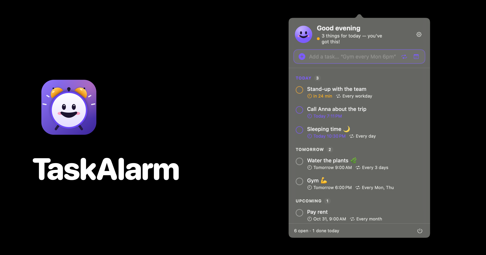
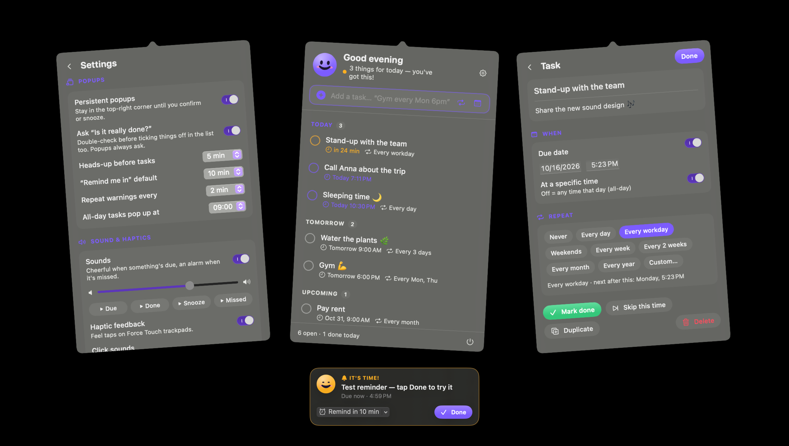

<p align="center"></p>

<h1 align="center">TaskAlarm</h1>

<p align="center">The to-do list that cheers you on.</p>

## Install

Paste this into Terminal:

```bash
curl -fsSL https://raw.githubusercontent.com/maxlkatze/taskalarm/main/install.sh | bash
```

It downloads the latest release into `/Applications` and launches it. Look for the smiley in your
menu bar. Prefer building it yourself? Add `-s -- --source` to the end of that command, or see
[Build from source](#build-from-source).

<p align="center"></p>

## Using it

- **Click the smiley** in the menu bar to open your list. Right-click for a small menu.
- **Type naturally** in the add field:
  - `Call Anna tomorrow 3pm`
  - `Daily every workday 8:30am`
  - `Sleeping time every day 10pm`
  - `Gym every Mon and Thu 6pm`
  - `Pay rent every month` · `Review every 3 days` · `Meeting in 2 hours`
  - German works too: `Zahnarzt morgen um 10 Uhr`, `Sport jeden Montag 18 Uhr`
- Or use the **repeat** and **calendar** buttons next to the field.
- **Click a task** to open its page: notes, date/time, repeat (presets or custom: every N days/weeks/months/years, specific weekdays), skip, duplicate, delete.
- **Right-click a task** for quick actions (move to today/tomorrow, snooze, skip, …).

## Reminders

1. **Heads-up** (default 5 min before, optional): a gentle "Coming up" card.
2. **It's time!**: a warm chime and a card in the top-right corner.
   With *persistent popups* on, it stays until you press **Done** (and confirm "Is it really done?")
   or **Remind in…** 5–30 minutes.
3. **Missed**: after a 5-minute grace period it turns red, plays a soft *ding-dong* alarm, shakes,
   and repeats every few minutes until handled.

## The smiley

Its color shows the status (green = all clear, amber = something's up, red = missed).
Its face is always encouraging: happy, eager when you have things to do today, excited when
something's due, celebrating when you finish. It only looks worried if something was missed.

The look, words, and sounds all follow the [brand language](BRAND.md).

## Build from source

Requires macOS 14+ and the Xcode command line tools.

```bash
./scripts/build.sh            # builds build/TaskAlarm.app (universal)
./scripts/build.sh --install  # also copies it to /Applications and launches it
./scripts/build.sh --zip      # also packages build/TaskAlarm.zip for a release
```

## Privacy

Everything stays on your Mac. Tasks are stored in
`~/Library/Application Support/TaskAlarm/tasks.json`. No accounts, no network, no tracking.

## Uninstall

Quit TaskAlarm from its right-click menu, then:

```bash
rm -rf /Applications/TaskAlarm.app ~/Library/Application\ Support/TaskAlarm
```
